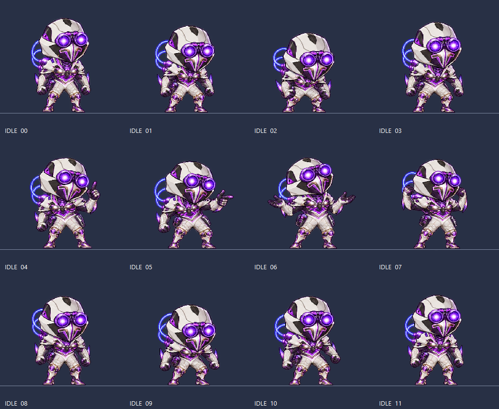

# Desktopper

可扩展角色素材的 Windows 原生桌宠，使用 Python + PySide6。当前内置 **Octane「蜘蛛热」V2.1**：透明置顶窗口、自动移动与边缘转向、拖拽、右键菜单、等比缩放，以及 Idle / Walk / Stim → Run / Knife / Jump Pad 动画。



后续角色放入独立的 `pets/<角色名>/` 文件夹，通过 `--config` 启动，无需修改现有 Octane 素材。详见 [添加其他桌宠](pets/README.md)。

## 启动与缩放

从 GitHub Releases 下载 Windows ZIP，完整解压后双击 `Desktopper\Desktopper.exe`。无需安装 Python；分享时复制整个 `Desktopper` 文件夹，不能只复制 EXE。源码构建的输出位于 `dist\Desktopper\`。

左键拖拽，右键选择动作、暂停、自动活动或退出。右键 → **大小（等比缩放）** 提供 50%、75%、100%、125%、150%、200%，也可自定义整数百分比。鼠标放在角色上 **Ctrl＋滚轮** 每次调整 5%。默认 100% 是 280×280 逻辑像素窗口。

缩放从 512×512 原帧实时绘制，保持宽高比、动画进度和脚底锚点；屏幕边缘会限制位置，避免放大后移出可见区域。比例保存在 EXE 同目录 `user-settings.json`，重启恢复。源码版使用项目根目录的设置文件。无法写入设置时，本次缩放仍生效。

## 本次修正

- 原来每帧等长、整图顺序播放；现在按准备、加速、腾空、落地、收势分别设置停留时间。
- Idle 在呼吸、蹲起、挑衅之间增加自然停留和恢复姿势。
- Walk 去掉末排转身姿势，使用一致朝向的小碎步往复序列，避免每圈突然转身。
- Run 保留一次完整扎针，再进入起跑和冲刺；起跑姿势只出现一次，后续从 `loop_start` 开始循环。移速逐渐提升，准备切换时减速。
- 蝴蝶刀保留近身翻刀和转刀，跳过大幅度过顶姿势，最后合刀、收刀、回待机。
- 跳板跳过原图中跳板消失的第 08 帧，补上已有腾空姿势的下降段；第二次落地后离开并收回跳板，再回待机。
- 行走、冲刺在预设收脚点切换；从移动进入道具互动前先停稳。KNIFE / JUMPPAD 不会被手动请求截断，最新请求排队，在收势和中性待机后接续。悬停提示显示接下来的动作。
- 移动改为沿当前高度水平活动，避免行走时随机上下漂移。

**没有重绘或生成新的角色图，也没有用叠影淡化来掩盖跳帧。** 这是对现有素材的选帧、回程、节奏和接续修正。原图中缺少真实中间姿态、部分跑步特效互相跨格的问题仍受素材限制。保留的 72 张独立原帧不变，播放序列会复用适当姿势，不能把播放位置数量当成新增原画数量。

## 动画配置

`assets/animations.json` 为当前播放配置，修改后重启。打包版本使用 EXE 同目录中的该文件。

| 字段 | 含义 |
|---|---|
| `frames` | 精灵图原始帧号，可重排或复用，编号从 0 开始 |
| `durations_ms` | 对应每个播放位置的停留毫秒数，必须与 frames 等长 |
| `fps` | 未设置 durations_ms 时的帧率；设置后以 durations_ms 为准 |
| `loop_start` | 非单次动作完成首轮后从哪个播放位置继续循环 |
| `exit_frames` | 可以接续下一动作的播放位置，使用列表下标而非原图帧号 |
| `next` | STIM → RUN，KNIFE / JUMPPAD → IDLE |
| `movement.acceleration` | 移速每秒变化量，默认 900 |
| `movement.walk_speed` / `run_speed` | 默认 75 / 300 逻辑像素每秒 |
| `display_height` | 100% 时的基础窗口尺寸，默认 280 |
| `pixelated` | 默认 true，近邻缩放；false 为平滑缩放 |

当前播放位置数：Idle 14、Walk 12、Stim 4、Run 12、Knife 15、Jump Pad 20。它们来自原有素材，不代表新绘制帧数。自动活动的动作权重和停留区间仍可在 `movement` 配置。

旧配置保留为 `assets/animations-v2-original.json`；原始 PNG 在 `assets/sources/v2/`，独立帧和标准图集在 `assets/v2/`。仓库不包含历史 EXE 和本机设置。

## 开发和验证

Windows 10/11、64 位 Python 3.10+（本地打包验证为 Python 3.12）。

```powershell
# 首次安装依赖
powershell -NoProfile -ExecutionPolicy Bypass -File .\setup.ps1

# 启动源码
.\.venv\Scripts\python.exe main.py

# 检查配置与素材
.\.venv\Scripts\python.exe main.py --check

# 单元与窗口交互测试
.\.venv\Scripts\python.exe -m unittest discover -s tests -v

# 原生窗口连续演示与检查：动作排队、腾空缩放、落地接续、冲刺循环、菜单退出
.\.venv\Scripts\python.exe tools\review_runtime.py

# 打包
powershell -NoProfile -ExecutionPolicy Bypass -File .\build.ps1

# 生成发布 ZIP 和 SHA-256 校验文件
.\.venv\Scripts\python.exe tools\package_release.py
```

本版验证包括 28 项自动测试，以及使用真实 Qt 计时器和窗口绘制的连续运行检查。原生检查记录和尺寸截图位于 `docs/review-v2.1/`。它会验证单次动作每个播放位置都出现、跳板结束后才接续扎针、缩放不重置动作、置顶透明窗口和菜单退出。

GitHub Actions 会执行测试并生成 Windows 构建产物。角色包与程序分离；配置格式见上表及 [角色包说明](pets/README.md)。依赖和图像来源见 [第三方说明](THIRD_PARTY_NOTICES.md)。
